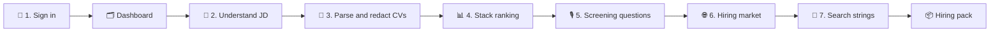
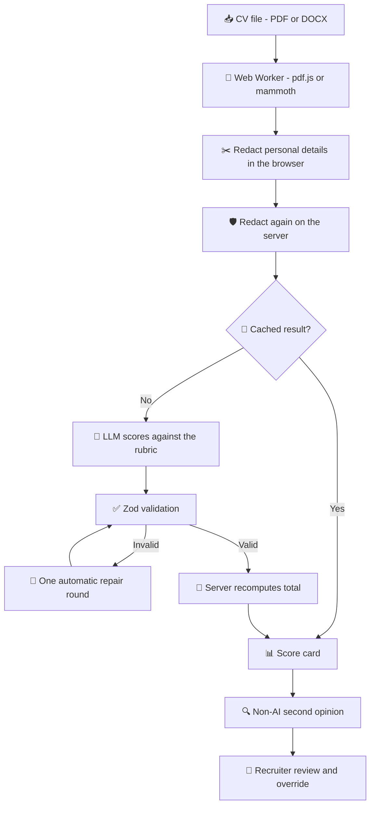
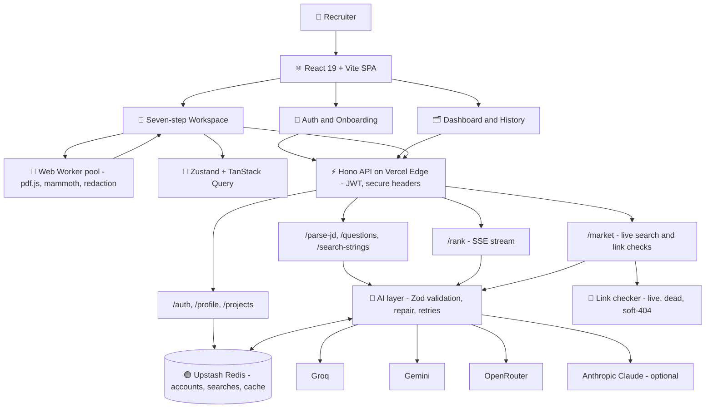
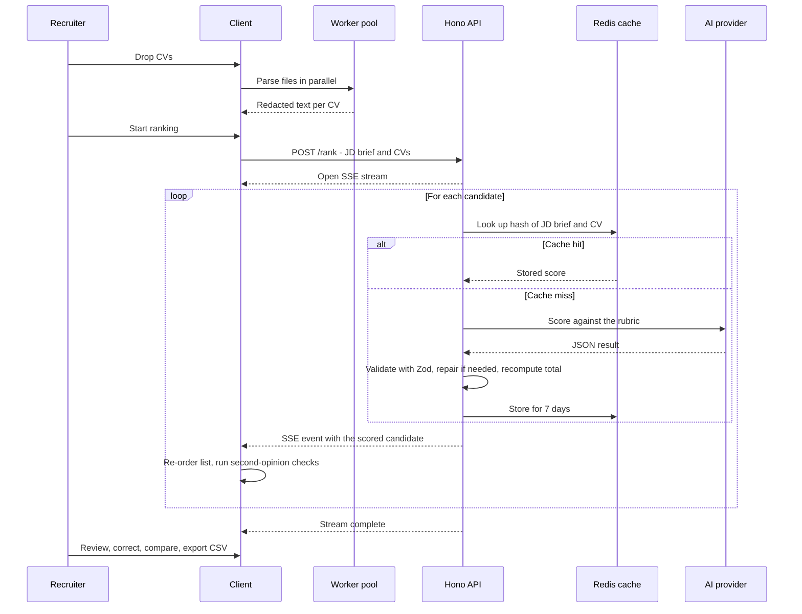
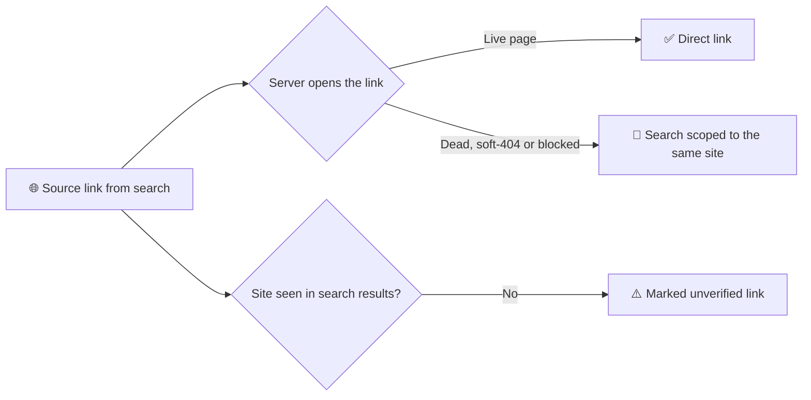
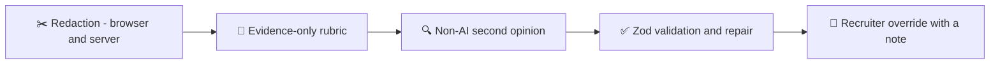
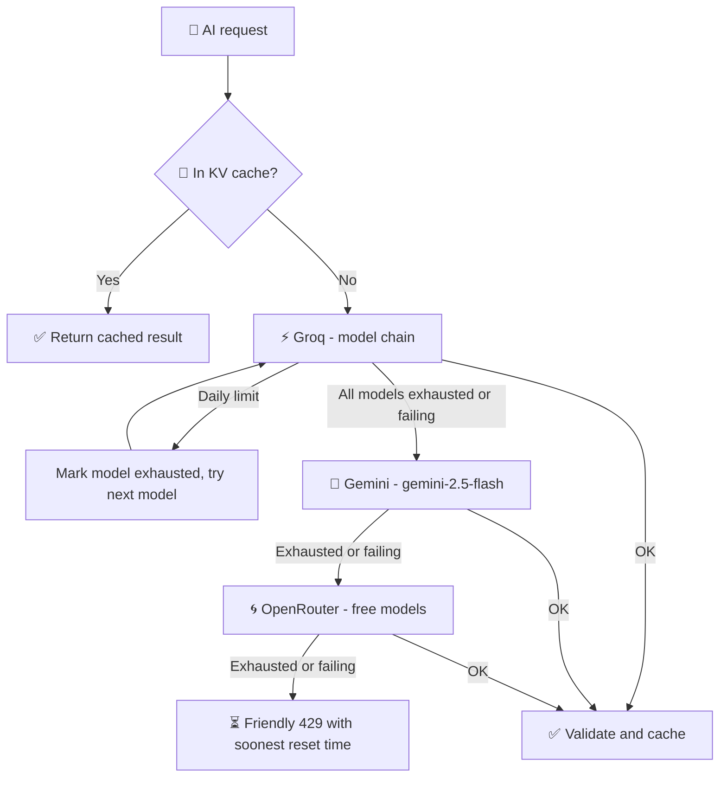
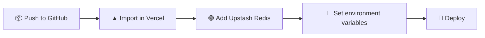

<div align="center">



<br/>

**An AI recruitment desk that takes a recruiter from a job description to a ranked, explained shortlist, then to screening questions, market data and sourcing strings, with evidence behind every score.**

<br/>


</div>

## Table of Contents

1. [Overview](#1-overview)
2. [Key Features](#2-key-features)
3. [How It Works](#3-how-it-works)
4. [Architecture](#4-architecture)
5. [Tech Stack](#5-tech-stack)
6. [Fairness and Checking the AI](#6-fairness-and-checking-the-ai)
7. [AI Providers, Rate Limits and Caching](#7-ai-providers-rate-limits-and-caching)
8. [Project Structure](#8-project-structure)
9. [Getting Started](#9-getting-started)
10. [Configuration](#10-configuration)
11. [Deploy to Vercel](#11-deploy-to-vercel)
12. [Testing](#12-testing)

---

## 1. Overview

Screening a pile of CVs against a job description is slow, inconsistent and easy to bias. Keyword matchers reward CVs that *list* the right words, and black-box AI scores are hard to trust or defend.

**Sift** is a recruiter-only workspace that uses LLMs for the heavy lifting but keeps the recruiter in control. Personal details are **redacted before any CV reaches the AI**, every score is broken down against a published rubric, every evidence quote is **checked against the CV text**, and a non-AI second opinion flags anything that does not add up. The recruiter can override any score, and the override is recorded with a note.

| Step | What Sift does |
|---|---|
| **1. Sign in** | Recruiter accounts, profile setup and a dashboard of saved, renamable searches |
| **2. Understand the JD** | Parses a PDF, Word file or pasted text into an editable brief |
| **3. Parse CVs** | Bulk-parses PDFs and Word files in a Web Worker pool and redacts personal details |
| **4. Rank** | Streams an evidence-based stack ranking with a score breakdown per candidate |
| **5. Screen** | Generates 10 screening questions and a keyboard-driven Call mode |
| **6. Market** | Runs a live web search for pay and hiring data, and checks every source link |
| **7. Source** | Produces LinkedIn and Naukri search strings and a downloadable hiring pack |

### Pages at a glance

| Route | Page |
|---|---|
| `/` | Public landing page (the Sift logo everywhere links here) |
| `/auth` | Recruiter sign in and account creation (name, work email, password) |
| `/onboarding` | Basic recruiter profile, required once after sign-up |
| `/app` | Dashboard: profile card, stats, recent history with inline rename, search, filters, resume and delete |
| `/app/p/:id` | The seven-step workspace for one saved search. Autosaves; the title is editable in the header |
| `/app/profile` | Edit profile |

> **Demo account:** `recruiter@demo.com` / `Demo@123`

---

## 2. Key Features

### 🔐 Recruiter accounts and history
- Sign-up with validation, PBKDF2-hashed passwords (Web Crypto) and 12-hour JWT sessions
- One-click demo recruiter access
- Route guards that enforce profile setup before the app
- A dashboard of saved searches with inline rename, search, filters, resume and delete; every workspace autosaves

### 📄 Job description understanding
- Upload a PDF or `.docx`, or paste text
- Results stream into an **editable bento grid**; anything the recruiter changes is tagged **"Corrected by you"**

### 🧵 Parallel CV parsing with redaction
- Bulk drop of PDFs and Word files, parsed by a **Web Worker pool** (pdf.js and mammoth, wired with Comlink)
- Live per-thread view with parse timings
- Name, gender, age, date of birth, marital status, religion, nationality, family details, photo, email, phone and links are **removed inside the worker**, before anything leaves the browser
- **"What the AI sees"** highlights every redaction

### 📊 Evidence-based stack ranking
- Scores **stream in live** over Server-Sent Events, with a progress bar and skeletons for pending CVs
- Published rubric: skills backed by real work **(50)**, relevant experience **(25)**, project and domain fit **(15)**, education **(10)**. The server recomputes the total from the breakdown
- Score distribution histogram, filters (All, Review, Shortlist) and Shortlist / Hold / Reject decisions
- Candidate drawer with a radar chart, breakdown bars, evidence quotes, an automatic check and a **score-correction slider with a note**
- Compare up to 3 candidates with overlaid radar charts, and export to CSV

### 🎙️ Screening questions and Call mode
- 10 questions (4 technical, 3 experience, 3 fit) in an accordion with category filters
- **Call mode:** a keyboard-driven carousel for use during a live call

### 🌐 Live hiring-market insights
- Live web search with a pay-landscape range chart and card or table views
- A named source or an **"Estimate"** label on every row, the search queries shown, and per-row **"Checked"** tracking
- **Every source link is opened by the server before it is shown.** Dead links, soft-404 pages and sites that block checks are replaced with a working search scoped to the same site, so a link never lands on a 404
- Every company also gets an **"Openings"** search link

### 🔎 Sourcing strings and hiring pack
- LinkedIn and Naukri strings, both Boolean and plain
- Boolean editor with **live syntax highlighting**, bracket and quote balance checking and a character budget
- Download the full **hiring pack** as Markdown

### ✨ Experience
- **⌘K / Ctrl+K** command palette
- GPU-animated, pointer-reactive particle wave (React Three Fiber with a custom GLSL shader, lazy-loaded)
- Layout animations for re-ordering, reduced-motion support, visible keyboard focus and a responsive layout down to mobile

---

## 3. How It Works

### Recruiter journey



### Scoring rubric

| Criterion | Weight | What earns credit |
|---|:---:|---|
| **Skills backed by real work** | 50 | Skills demonstrated in jobs or projects. A skill that is only listed earns at most half credit |
| **Relevant experience** | 25 | Roles and responsibilities that match the brief |
| **Project and domain fit** | 15 | Projects and domains close to the role |
| **Education** | 10 | Relevant qualifications |
| **Total** | **100** | Recomputed on the server from the breakdown, never trusted from the model |

### From a CV to a trusted score



---

## 4. Architecture

### System architecture



### Streaming ranking workflow



### Market link verification



---

## 5. Tech Stack

| Layer | Technology | Why |
|---|---|---|
| Language | **TypeScript 7** (strict) | One type system across client, server and AI schemas |
| Build | **Vite 8** (Rolldown) | Fast dev server and a code-split production build |
| UI | **React 19**, **Tailwind CSS v4** | Modern React with a CSS-first design token system |
| Components | **Radix UI** primitives (shadcn-style), **cmdk**, **vaul**, **sonner** | Accessible tabs, dialogs, sliders, accordions, toggle groups, ⌘K palette, drawers and toasts |
| Motion | **Motion** (Framer Motion) | Re-ordering ranking, shared-layout pills and staggered reveals |
| 3D | **React Three Fiber + Three.js** with a custom GLSL shader | GPU-animated, pointer-reactive particle wave (lazy-loaded) |
| State | **Zustand** (persisted) + **TanStack Query** | Session state survives refresh; mutations handle loading and errors |
| Parallelism | **Web Workers + Comlink** | PDFs and Word files parse in parallel off the main thread |
| Parsing | **pdf.js**, **mammoth** | PDF and `.docx` text extraction in the browser |
| Routing | **React Router** with route guards | Landing, auth, onboarding, dashboard and workspace |
| API | **Hono** on **Vercel Edge Functions** | One small, fast, web-standard API with JWT auth and secure headers |
| Data | **Upstash Redis** (REST, Edge-compatible) | Accounts, profiles, saved searches and the AI result cache |
| Security | **Web Crypto** (PBKDF2), JWT | Password hashing and 12-hour sessions |
| Streaming | **Server-Sent Events** | Ranking streams each candidate as it is scored; long web searches stay alive |
| Validation | **Zod v4** | Every request and every AI response is validated, coerced and auto-repaired |
| AI | **Groq** (default), **Gemini**, **OpenRouter**, optional **Anthropic Claude** | A provider fallback chain; Groq browser search or Claude web search for market data |
| Testing | **Vitest**, **Playwright** | Unit tests and end-to-end tests |

---

## 6. Fairness and Checking the AI



| Safeguard | How it works |
|---|---|
| **Redaction before the AI** | Personal details are removed in the browser worker and again on the server |
| **Evidence-only rubric** | Skills that are only listed earn at most half credit |
| **Second opinion** | A non-AI check flags matched skills that never appear in the CV (`skill?`), quotes that are not in the CV, and score and keyword disagreements |
| **Validation and repair** | Malformed AI output gets one automatic repair round; otherwise a clear error is shown |
| **Recruiter override** | The recruiter can correct a score with a note. The list re-orders and shows **"AI said X"** |
| **Market sources** | Every row has a named source or an "Estimate" label. Links whose site did not appear in the search results are marked **"unverified link"** |
| **No scraping** | LinkedIn and Naukri are never scraped; Sift only writes search strings for them |

---

## 7. AI Providers, Rate Limits and Caching

Sift stays usable on free tiers through a provider fallback chain set by `AI_PROVIDERS="groq,gemini,openrouter"`.



### Provider chain
- Providers are tried in order. A provider without an API key is **silently skipped**.
- A request moves to the next provider only when the current one is exhausted or failing (429, 5xx, timeouts, or every model skipped).
- When every provider is exhausted, Sift returns a friendly 429 with the **soonest reset time**, without exposing provider or model names.

### Groq
- Quotas are enforced per model and per organisation.
- On a daily limit (TPD or RPD), the wait time is parsed, the model is marked exhausted in memory and in KV (`ai:exhausted:<model>`), and the next model is tried immediately.
- On a per-minute limit (TPM or RPM), Sift waits for `retry-after` (up to 8 s) once before falling back.
- Decommissioned models (404) are skipped permanently.

### Gemini
- A free backup through the Gemini REST API (`gemini-2.5-flash`) when Groq is exhausted or not configured.

### OpenRouter (free tier)
- **Model auto-discovery:** if `OPENROUTER_MODELS_FAST` or `OPENROUTER_MODELS_HEAVY` are unset, Sift reads `https://openrouter.ai/api/v1/models`, keeps free models (IDs ending in `:free`) with at least 32,000 tokens of context, and prefers text-only instruct and chat models. The list is cached in memory and in KV (`ai:or:models`) for 1 hour. Heavy tasks use the 3 largest-context models; fast tasks use the first 3. Endpoints returning 404 or "No endpoints found" are pruned.
- **Token bucket:** free models allow about 20 requests per minute (bucket default `OPENROUTER_RPM=18`) and 50 requests per day without credits. With an empty bucket, Sift waits up to 4 s or moves on.
- **Limits:** `X-RateLimit-Reset` is respected on 429. A daily limit marks OpenRouter exhausted (`ai:exhausted:openrouter`) until the next UTC midnight; a 402 marks it exhausted for 1 hour. For `/rank`, concurrency is capped at 2 when there are more than 2 batches.
- **Web search for `/market`:** off by default, where Sift's link checks and "Estimate" labels apply. `OPENROUTER_WEB=1` enables the paid web search plugin (`plugins: [{ id: "web", max_results: 5 }]`).

### Result cache

| Endpoint | Cache key | Lifetime |
|---|---|---|
| `parse-jd`, `questions`, `search-strings` | `ai:cache:<sha256>` | 7 days |
| `rank` (per candidate) | `hash(jdBrief + cvText)` | 7 days |
| `market` | `ai:cache:<sha256>` | 24 hours |

Ranking is cached per candidate, so re-running a search or adding one CV only calls the AI for profiles that are not cached yet. A cache hit skips every provider.

---

## 8. Project Structure

```bash
Sift-AI-Recruitment-Desk/
│
├── api/
│   ├── index.ts                 # Vercel Edge entry (hono/vercel handle)
│   └── _lib/
│       ├── app.ts               # Hono routes: auth, profile, projects, parse-jd, rank (SSE), questions, market, search-strings
│       ├── ai.ts                # Providers, retries with backoff, Zod-validated JSON + repair, concurrency pool
│       ├── prompts.ts           # Prompts and the scoring rubric
│       ├── links.ts             # Live link checks and site-scoped search fallbacks
│       ├── kv.ts                # Redis REST client with in-memory fallback
│       ├── users.ts             # Accounts, PBKDF2 password hashing, demo accounts
│       └── projects.ts          # Saved searches and dashboard summaries
│
├── shared/
│   └── schemas.ts               # Zod schemas and types shared by client and server
│
├── src/
│   ├── pages/                   # Landing, Auth, ProfileSetup, Dashboard, Workspace
│   ├── features/                # One screen per workspace step (code-split)
│   ├── components/
│   │   ├── ui/                  # Button (cva), Badge, Radix primitives, SpotlightCard
│   │   ├── fx/                  # ParticleField (R3F shader), Aurora, NumberTicker, ScoreRing, RadarChart, confetti
│   │   └── ...                  # Sidebar, CommandMenu, Dropzone, shared blocks
│   ├── workers/
│   │   └── parser.worker.ts     # pdf.js + mammoth + redaction, exposed with Comlink
│   ├── lib/                     # SSE client, worker pool, AI checks, exports
│   └── store/                   # Zustand stores (auth in sessionStorage, session in localStorage)
│
├── sample-data/                 # Fictional JD and 7 fictional CVs (4 PDF, 3 Word)
├── tests/                       # Vitest and Playwright tests
├── scripts/                     # Helper scripts
├── public/                      # Static assets
├── docs/
│   └── banner.svg               # README banner
│
├── .env.example
├── vercel.json                  # /api/* to the Edge Function, everything else to the SPA
├── vite.config.ts
├── vitest.config.ts
├── playwright.config.ts
├── tsconfig.json
└── package.json
```

---

## 9. Getting Started

### 9.1 Prerequisites

| Requirement | Version |
|---|---|
| Node.js | 20 or newer |
| npm | Comes with Node.js |
| An AI key | At least one of Groq ([console.groq.com/keys](https://console.groq.com/keys)), Gemini, OpenRouter or Anthropic |

### 9.2 Clone and install

```bash
git clone https://github.com/LoganthP/Sift-AI-Recruitment-Desk.git
cd Sift-AI-Recruitment-Desk
npm install
```

### 9.3 Configure

```bash
cp .env.example .env
```

Open `.env` and add at least `GROQ_API_KEY`. Every other setting is optional (see [Configuration](#10-configuration)).

> Without Upstash Redis credentials, Sift keeps accounts and history **in memory**. This is fine for local development, but the data resets whenever the server restarts.

### 9.4 Run

```bash
npm run dev
```

Open **http://localhost:5173**. One dev server serves both the React app and the Hono API.

Sign in with `recruiter@demo.com` / `Demo@123`, or create an account.

### 9.5 Scripts

| Command | Purpose |
|---|---|
| `npm run dev` | Start the app and the API on port 5173 |
| `npm run typecheck` | Type-check the whole project |
| `npm run build` | Type-check, then create a production build |
| `npm run preview` | Preview the production build |
| `npm test` | Run the Vitest suite |
| `npm run test:e2e` | Run the Playwright end-to-end tests |

---

## 10. Configuration

All variables except one AI key are optional.

| Variable | Default | Description |
|---|---|---|
| `GROQ_API_KEY` | none | Required for Groq, the default provider |
| `GROQ_MODELS_FAST` | `openai/gpt-oss-20b,llama-3.1-8b-instant` | Model chain for fast tasks |
| `GROQ_MODELS_HEAVY` | `openai/gpt-oss-120b,openai/gpt-oss-20b,llama-3.3-70b-versatile` | Model chain for heavy tasks |
| `AI_PROVIDERS` | `groq,gemini,openrouter` | Provider order |
| `GEMINI_API_KEY` | none | Optional free backup provider |
| `OPENROUTER_API_KEY` | none | Optional third provider ([openrouter.ai/keys](https://openrouter.ai/keys)) |
| `OPENROUTER_MODELS_FAST` | auto-discovered | Comma-separated model list |
| `OPENROUTER_MODELS_HEAVY` | auto-discovered | Comma-separated model list |
| `OPENROUTER_RPM` | `18` | Free-tier token bucket |
| `OPENROUTER_WEB` | `0` | `1` enables the paid web search plugin for market data |
| `ANTHROPIC_API_KEY` | none | Optional Claude provider |
| `ANTHROPIC_MODEL` | `claude-sonnet-5-5` | Claude model |
| `APP_URL` | `http://localhost:5173` | Public app URL |
| `KV_REST_API_URL`, `KV_REST_API_TOKEN` | none | Set by the Upstash integration; in-memory fallback without them |
| `AUTH_SECRET` | dev fallback | Long random string for signing JWTs. **Set it in production** |
| `DEMO_EMAIL`, `DEMO_PASSWORD` | `recruiter@demo.com`, `Demo@123` | Demo account |

---

## 11. Deploy to Vercel



1. **Import the repository.** Push to GitHub, then in Vercel choose **Add New → Project** and import the repo. It is detected as a Vite project.
2. **Add the database.** In the Vercel project, go to **Storage → Marketplace → Upstash for Redis → Create** and connect it to the project. This sets `KV_REST_API_URL` and `KV_REST_API_TOKEN` automatically. The free tier is enough.
3. **Set environment variables.** Add `GROQ_API_KEY` (or another provider key), `AUTH_SECRET`, and optionally `GEMINI_API_KEY`, `OPENROUTER_API_KEY`, `DEMO_EMAIL` and `DEMO_PASSWORD`.
4. **Deploy.** `vercel.json` sends `/api/*` to the single Edge Function at `api/index.ts` and every other path to the app, so deep links such as `/app/p/…` work on refresh.

> If Vercel ever rejects the Edge runtime, delete the `runtime: 'edge'` line in `api/index.ts`. The same code runs on Node.

---

## 12. Testing

```bash
npm run typecheck     # strict TypeScript across client, server and shared schemas
npm test              # Vitest unit tests
npm run test:e2e      # Playwright end-to-end tests
```

For the Playwright tests, install the browsers once with `npx playwright install`.


<sub>All sample people and companies in this repository are fictional.</sub>

</div>
